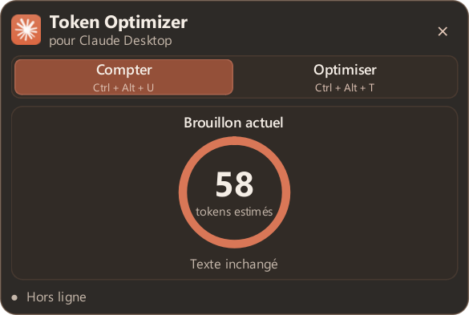
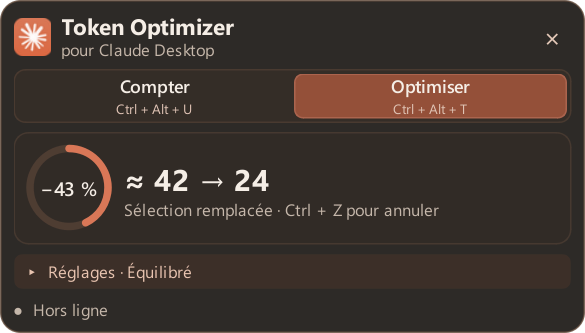
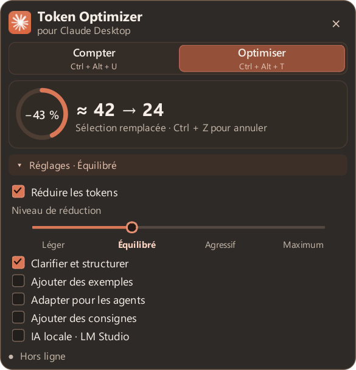

# Claude Optimizer Token

Un petit utilitaire Windows qui **estime les tokens d’un brouillon** et **raccourcit le texte sélectionné** dans Claude Desktop. Il tourne en arrière-plan et affiche sa bulle noire et terracotta uniquement à la demande. Par défaut, tout le traitement se fait hors ligne, sans clé API.

## Aperçu

| Compter · Ctrl + Alt + U | Optimiser · Ctrl + Alt + T |
| :---: | :---: |
|  |  |

<details>
<summary>Voir le panneau Réglages</summary>



</details>

*Captures de démonstration réalisées avec des valeurs fictives, sans conversation Claude.*

## Installation sur Windows

**Prérequis :** Windows 11 x64, [Python 3.13 x64](https://www.python.org/downloads/windows/) et [Claude Desktop pour Windows](https://claude.com/download). L’utilitaire reconnaît le client installé sous `%LOCALAPPDATA%\AnthropicClaude`. La version Microsoft Store, le navigateur et Claude Code ne sont pas pris en charge.

1. Clone le dépôt avec ton compte GitHub autorisé, puis ouvre le dossier dans PowerShell. Sans Git, utilise **Code → Download ZIP** sur GitHub, décompresse l’archive et ouvre PowerShell dans le dossier qui contient `Activer.pyw`.

   ```powershell
   git clone https://github.com/mohamedidrissnaour/ClaudeOptimizerToken.git
   cd ClaudeOptimizerToken
   ```

2. Crée l’environnement Python et installe les dépendances. Cette étape nécessite Internet ; l’utilitaire n’en a pas besoin ensuite.

   ```powershell
   py -3.13 -m venv .venv
   .\.venv\Scripts\python.exe -m pip install -r requirements.txt
   ```

3. Lance l’utilitaire. Si une ancienne instance est déjà active, quitte-la d’abord depuis la zone de notification.

   ```powershell
   .\.venv\Scripts\pythonw.exe .\Activer.pyw
   ```

   Aucune fenêtre ne s’ouvre au lancement. L’icône **Token Optimizer** près de l’horloge confirme que le programme est en arrière-plan. Si elle n’est pas visible, ouvre **˄ Afficher les icônes masquées**.

### Raccourci sur le Bureau (facultatif)

Sur le Bureau, fais **clic droit → Nouveau → Raccourci**. Colle la cible ci-dessous en remplaçant les deux chemins par ceux de ton dossier :

```text
"C:\chemin\ClaudeOptimizerToken\.venv\Scripts\pythonw.exe" "C:\chemin\ClaudeOptimizerToken\Activer.pyw"
```

Nomme-le **Claude Optimizer Token**. Le raccourci active simplement l’utilitaire pour la session Windows ; rien n’est ajouté au démarrage automatique. Pour le quitter, fais un clic droit sur son icône près de l’horloge et choisis **Quitter Token Optimizer**.

## Première utilisation

1. Ouvre l’onglet **Chat** de Claude Desktop et colle ce texte dans le champ sans l’envoyer :
   `S’il te plaît, explique de manière concise pourquoi il ne faut pas dépasser 120 caractères.`
2. Garde le curseur dans le champ et presse **Ctrl + Alt + U**. La bulle **Compter** estime les tokens de **tout le brouillon**, sans le modifier.
3. Sélectionne le texte à raccourcir et presse **Ctrl + Alt + T**. Avec les règles locales, seule **la sélection** peut être remplacée. La bulle **Optimiser** affiche l’estimation avant et après, ou indique qu’il n’y a pas de changement. Le reste du brouillon est préservé.
4. Relis le résultat dans Claude. **Ctrl + Z** dans le champ permet d’annuler le remplacement. L’utilitaire ne clique jamais sur **Envoyer**. La bulle se masque avec **×**, à la remise à zéro du brouillon ou quand tu changes d’application.

## Réglages

Dans **Optimiser → Réglages**, choisis un niveau : **Léger**, **Équilibré**, **Agressif** ou **Maximum**. Commence par **Équilibré**, avec **Réduire les tokens** et **Clarifier et structurer** activés. Le moteur de règles traite surtout le français et l’anglais et peut laisser intact un texte déjà concis. Le niveau ne force pas une réduction au prix des contraintes.

- **Ajouter des exemples** : renseigne une entrée et une sortie.
- **Adapter pour les agents** : structure le prompt destiné à un flux de travail avec un agent.
- **Ajouter des consignes** : ajoute une exigence comme « Réponds en YAML » ou utilise une règle de forme reconnue comme « pas de tirets ». Les champs d’exemples et de consignes ne sont pas enregistrés.

Ajouter du contenu peut augmenter le nombre de tokens. Après avoir modifié les réglages, reprends la sélection dans Claude, puis relance **Ctrl + Alt + T**.

### Réécriture IA locale (facultative)

1. Dans [LM Studio](https://lmstudio.ai/docs/developer/core/server), charge un modèle **GGUF** déjà téléchargé et démarre le serveur sur `127.0.0.1:1234`. Laisse le partage réseau désactivé. L’utilitaire ne démarre ni LM Studio ni un téléchargement.
2. Coche **IA locale · LM Studio** dans les réglages. Elle est désactivée par défaut. Elle s’applique à une sélection courte de texte simple, sans options d’exemples, d’agents ou de consignes supplémentaires.
3. **Ctrl + Alt + T** affiche un aperçu si le modèle propose une réécriture admissible et plus courte. Rien n’est encore collé. Relis la proposition, puis presse **Ctrl + Alt + T** à nouveau sans modifier la sélection, ou clique sur **×** pour l’annuler.
4. Si le serveur n’est pas disponible, exige une authentification ou ne propose pas de texte admissible, l’outil revient aux règles locales.

## Ce que mesure le compteur

Les valeurs sont des **estimations BPE**, calculées hors ligne avec le [vocabulaire historique d’Anthropic](token_optimizer/assets/NOTICE-tokenizer.md). Elles portent sur le brouillon en mode **Compter** et sur la sélection en mode **Optimiser**. Elles n’incluent ni l’historique, ni les pièces jointes, ni les outils. Ce n’est pas une mesure du quota ou des crédits Claude. Le [comptage par modèle documenté par Anthropic](https://platform.claude.com/docs/en/build-with-claude/token-counting) passe par l’API et n’est pas utilisé ici.

L’utilitaire ne journalise pas les brouillons. Il utilise brièvement le presse-papiers pour le remplacement et tente de restaurer son contenu précédent sans écraser une nouvelle copie. Avec l’option IA activée, seule la sélection concernée est transmise au serveur LM Studio de la machine ; ses propres journaux dépendent de sa configuration.

## Dépannage

| Symptôme | À faire |
| --- | --- |
| Rien près de l’horloge | Vérifie les icônes masquées, puis les dépendances dans `.venv`. Si le lancement échoue, consulte `%LOCALAPPDATA%\LocalTools\ClaudeTokenOptimizer\demarrage.log`. |
| Un raccourci ne répond pas | Mets le focus dans le champ de **Chat** et vérifie que Claude Desktop et l’utilitaire ne tournent pas en administrateur. Vérifie aussi que le raccourci n’est pas utilisé ailleurs. |
| Le champ Claude est inaccessible | Quitte Claude Desktop depuis son icône de notification. Lance [Ouvrir Claude en mode compatibilité](Ouvrir%20Claude%20-%20compatibilite.cmd) : ce script relance Claude avec l’accessibilité activée pour la session, sans modifier son installation. |
| Le presse-papiers ne peut pas être conservé | Copie un texte simple avant de relancer **Ctrl + Alt + T**. |
| Le collage est indiqué comme non confirmé | Regarde d’abord le brouillon. L’utilitaire ne réessaie pas automatiquement. |

## Sources et crédits

Les modules Python sont dans [`token_optimizer/`](token_optimizer/) et les tests dans [`tests/`](tests/). Le dépôt ne distribue pas d’exécutable ni l’icône d’Anthropic séparément : l’icône est récupérée depuis l’installation locale de Claude quand elle est disponible. Le vocabulaire fourni conserve [sa licence MIT d’origine](token_optimizer/assets/claude-historical.LICENSE).

**Projet indépendant, non officiel, sans affiliation avec Anthropic.**
